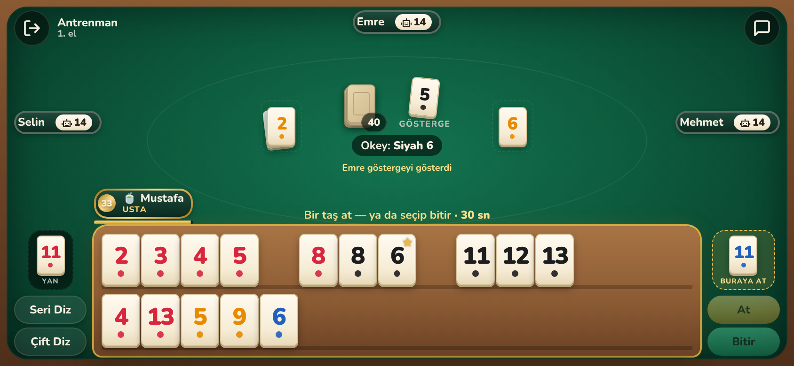
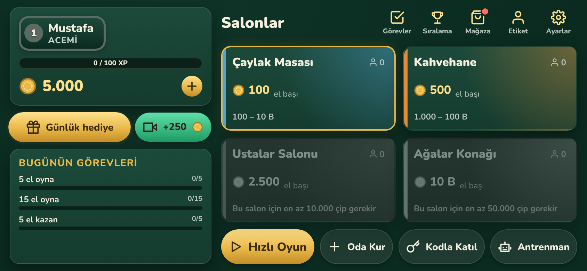
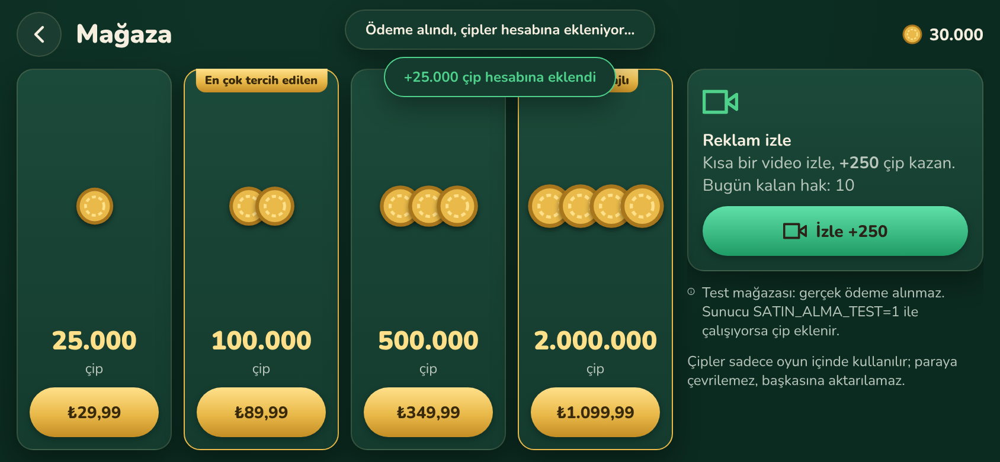
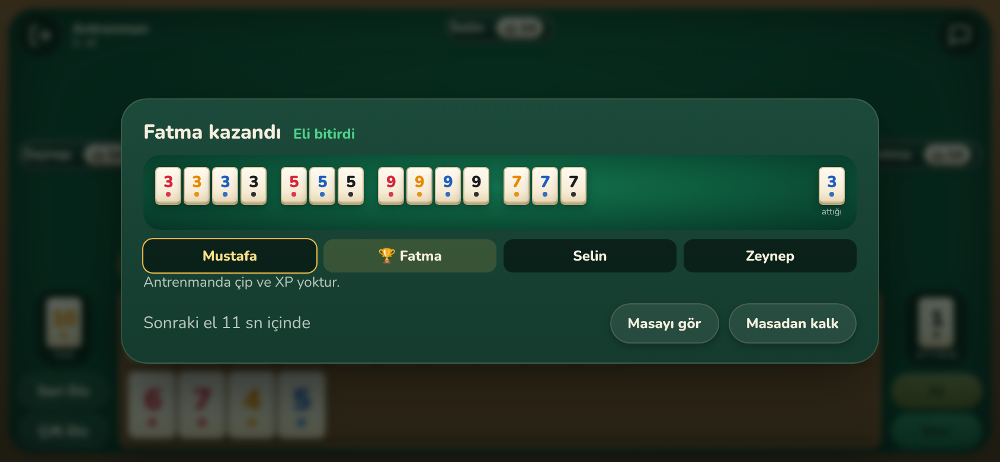

# Okey Salonu

Android için gerçek zamanlı, çok oyunculu **Okey** oyunu. Telefonda React + Capacitor, sunucuda Node.js + WebSocket. Oyun kuralları iki tarafın paylaştığı tek bir TypeScript paketinde; bütün kararları sunucu verir, bu yüzden istemciden hile yapılamaz. Google Play'e yüklenecek şekilde hazırlandı: uygulama içi satın alma, ödüllü reklam ve imzalı sürüm derlemesi hazır.

<p align="center">
  
</p>

| Lobi | Mağaza | El sonu |
| --- | --- | --- |
|  |  |  |

## Özellikler

**Oyun**
- Klasik Okey kuralları: 106 taş, gösterge ve okey, sahte okey, seri ve çift bitirme, okey atarak bitirme, gösterge gösterme.
- İstakada taşları sürükle bırak, tek dokunuşla **seri diz** ya da **çift diz**.
- Hamle süresi; süresi dolan ya da bağlantısı kopan oyuncunun yerine bot oynar, oyuncu geri dönünce masasına kaldığı yerden devam eder.
- Masada sohbet ve hızlı mesajlar.
- İnternetsiz **antrenman modu**: aynı oyun motoru telefonda botlara karşı çalışır.

**Online**
- **Hızlı oyun**: salonda yeri olan bir masaya oturur; masa 10 saniyede dolmazsa boş koltuklara bot oturur.
- **Özel oda**: 5 haneli kodla arkadaşlarınla oyna.
- **Salonlar**: her salonun giriş çipi ve oturmak için gereken çip aralığı var (Çaylak Masası, Kahvehane, Ustalar Salonu, Ağalar Konağı).

**Ekonomi ve ilerleme**
- Her elde herkes ortaya çip koyar, eli bitiren hepsini alır.
- Çip paketleri Google Play'den satın alınır; günlük hediye, ödüllü reklam, günlük görevler ve seviye ödülleriyle de kazanılır. Çip aktarılamaz ve paraya çevrilemez.
- Seviye sistemi, günlük görevler, seviye ve çip sıralamaları.
- Masa ve taşlar herkeste aynı; oyuncular sadece **isim etiketlerini** (çerçeve, rozet, unvan) süsler. Süsler satılmaz, seviye ve başarımlarla açılır.

## Mimari

```
packages/
  kurallar/   Taşlar, el bitirme algoritması, Masa, Oda, bot, ekonomi, protokol (saf TypeScript)
  sunucu/     WebSocket sunucusu, SQLite, satın alma ve reklam doğrulaması
  mobil/      React arayüzü + Capacitor Android projesi
docs/         Mimari, Google Play rehberi, gizlilik politikası, mağaza görselleri
```

Öne çıkan kararlar (ayrıntısı [docs/MIMARI.md](docs/MIMARI.md) dosyasında):

- **Sunucu otoritesi:** Desteyi sunucu karıştırır, her oyuncuya sadece kendi taşlarını içeren bir görünüm gönderir, her hamleyi ve "elim bitti" iddiasını kendisi doğrular.
- **Tek kural motoru:** `Oda` sınıfı ağdan habersizdir; sunucuda gerçek oyuncularla, telefonda antrenman modunda ve testlerde sahte saatle aynı kod çalışır.
- **El bitirme algoritması:** geri izleme (backtracking) ile kesin çözüm, bot için ezberleme (memoization) ile 20 kat hızlı puanlama.
- **Güvenli ödeme:** Google Play satın alma jetonu sunucuda Google API'sine sorularak doğrulanır, aynı jeton iki kez kullanılamaz. Ödüllü reklamı da telefon değil, AdMob'un imzalı isteğini doğrulayan sunucu verir.
- **Çip işlemleri** transaction içinde; bakiye eksiye düşemez, her değişim denetim tablosuna yazılır.

## Çalıştırma

Node 22 gerekir.

```bash
npm install

# Sunucu (test satın alma jetonlarını kabul eder)
SATIN_ALMA_TEST=1 npm run dev:sunucu

# Arayüzü tarayıcıda geliştirme (telefonu yatay boyuta getir, ör. 844x390)
npm run dev

# Testler ve tip denetimi
npm test
npm run typecheck

# 40 sanal oyuncuyla yük testi
npm run yuk-testi -w @okey/sunucu
```

Android derlemesi, imza ve Play'e yükleme adımları: [docs/GOOGLE_PLAY.md](docs/GOOGLE_PLAY.md). GitHub Actions her push'ta testleri çalıştırır ve test APK'sı üretir; "Run workflow" ile imzalı Play sürümü (AAB) çıkarılır.

## Kendin nasıl değiştirirsin?

| Ne | Nerede |
| --- | --- |
| Renkler, yazı tipi, taş ve masa görünümü | `packages/mobil/src/tema.css` (tek dosya) |
| Salonlar, giriş çipleri, çip paketleri, XP, görevler | `packages/kurallar/src/ekonomi.ts` |
| İsim etiketi çerçeveleri, rozetler, unvanlar | `packages/kurallar/src/kozmetik.ts` |
| Hamle süresi, bot hızı, eşleştirme bekleme süresi | `packages/sunucu/src/ayarlar.ts` |
| Mağaza görselleri | `docs/magaza/kaynak/` (sonra `bash docs/magaza/kaynak/uret.sh`) |

Örnek: yeni bir rozet eklemek için `kozmetik.ts` içindeki `ROZETLER` listesine `{ id, ad, simge, kosul }` satırı eklemek yeter; sunucu kilidi, telefon görünümü otomatik alır.

## Lisans

[MIT](LICENSE) © Mustafa Gültürk
