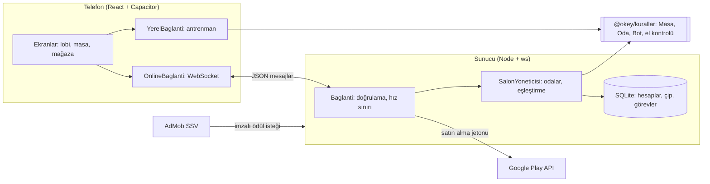

# Mimari ve Tasarım Kararları

Bu belge projenin nasıl çalıştığını ve kararların neden böyle verildiğini anlatır. Mülakatta "bu projeyi anlat" sorusuna hazırlık için yazıldı.

## Büyük resim

Depo üç paketten oluşan bir npm workspaces monoreposudur:

| Paket | Görevi |
| --- | --- |
| `packages/kurallar` | Oyunun kuralları ve oda motoru. Ağdan, veritabanından ve ekrandan habersiz saf TypeScript. Hem sunucuda hem telefonda aynı kod çalışır. |
| `packages/sunucu` | WebSocket sunucusu: hesaplar, salonlar, çip ekonomisi, görevler, sıralama, satın alma ve reklam doğrulaması. |
| `packages/mobil` | Android uygulaması: React arayüzü, Capacitor ile Android'e paketlenir. |

## 1. Sunucu otoritesi ve hile koruması

Online oyunlarda temel kural: **istemciye güvenme.** Telefon sadece "şu taşı çektim / attım" der; kararı sunucu verir.

- Desteyi sunucu karıştırır (`crypto` tabanlı rastgelelik), dağıtımı sunucu yapar.
- Her oyuncuya masanın tamamı değil, `Masa.gorunum(koltuk)` gönderilir. Bu görünümde sadece o oyuncunun kendi taşları vardır; diğerlerinin taşları ve ortadaki destenin sırası **hiçbir zaman** telefona gitmez. Uygulamayı kurcalayan biri bile başkasının taşını göremez. Bunu test eden bir test var (`sunucu/test/oyun.test.ts`).
- Taşlar 0-105 arası kimliklerle temsil edilir. "Kırmızı 7 attım" yerine "52 numaralı taşı attım" denir ve sunucu o taşın gerçekten oyuncunun elinde olup olmadığına bakar.
- "Elim bitti" iddiasını sunucu kendisi kontrol eder (`bitisBul`). İstemcinin dizdiği perlere bakılmaz.
- Gelen her mesaj zod şemasıyla doğrulanır (tür, uzunluk, aralık). 8 KB'den büyük mesaj, saniyede 20'den fazla mesaj ve giriş yapmadan gelen mesaj reddedilir.

## 2. Kuralların tek yerde olması

`Masa` sınıfı tek bir elin kurallarını, `Oda` sınıfı ise el el oyun akışını (koltuklar, botlar, süreler, sonraki el) yönetir. İkisi de dış dünyaya sadece fonksiyonlarla bağlanır (`OdaBaglami`: `gonder`, `zamanla`, `elBasinda`, `elSonunda`). Bu sayede aynı oda motoru:

- sunucuda gerçek oyuncular ve veritabanıyla,
- telefonda internetsiz antrenman modunda,
- testlerde sahte saatle (zamanı elle ilerleterek)

çalışır. Bu bir **bağımlılık enjeksiyonu** örneğidir; mülakatta "test edilebilir kod nasıl yazılır" sorusuna somut cevap.

## 3. El bitti mi? (algoritma)

Okey'de el, 14 taş perlere (aynı renk ardışık en az 3 taş ya da aynı sayı farklı renk 3-4 taş) veya 7 çifte ayrılabiliyorsa biter. Okey taşı her taşın yerine geçer.

- **Kesin çözüm (`perlereAyir`):** geri izleme (backtracking). Elde kalan en küçük taşı al, onu içeren bütün olası perleri dene, kalanı aynı şekilde çöz. En küçük taşı seçmek arama ağacını çok küçültür.
- **Hızlı puan (`seriKapsama`):** bot her hamlede 15 farklı atışı değerlendirdiği için daha hızlı bir sürüm gerekir. Taşları sadece "hangi türden kaç tane" olarak tutar ve aynı ara durumu tekrar hesaplamamak için sonuçları ezberler (**memoization / dinamik programlama**). Bu, ilk denemedeki 40 ms'yi 2 ms'nin altına indirdi. İki yöntemin aynı sonucu verdiği 150 rastgele elde test ediliyor.
- 12-13-1 geçerli, 13-1-2 geçersiz gibi özel durumlar için "konum 14 = 13'ten sonra gelen 1" fikri kullanıldı.

## 4. Bot

Basit ve açıklanabilir: bitirebiliyorsa bitirir (önce okey atarak, çünkü daha değerli), yandaki taş elini iyileştiriyorsa yandan çeker, atarken kalan elin puanını en yüksek tutan taşı atar. Bot sadece kendi görünümünü kullanır, yani hile yapmaz. Bot üç yerde kullanılır: boş koltuklar, bağlantısı kopan oyuncu ve süresi dolan hamle.

## 5. Gerçek zamanlı akış ve kopan bağlantılar

- WebSocket kullanıldı çünkü sunucunun oyunculara kendiliğinden mesaj göndermesi gerekiyor (rakip hamlesi, sohbet, süre). HTTP isteği-cevabı bunun için uygun değil.
- Her durum değişikliğinden sonra oda, her oyuncuya kendi görünümünü yeniden gönderir. Fark (diff) göndermek yerine tam görünüm göndermek daha basit ve hataya kapalı; bir masa görünümü 1-2 KB olduğu için maliyeti düşük.
- Bağlantısı kopan oyuncunun yerine bot oynar; aynı hesapla tekrar girince masaya geri döner. 30 saniyede bir ping ile ölü bağlantılar temizlenir.
- Hamle süresi dolarsa sunucu oyuncu adına taş çekip atar (ama el bitirmez).

## 6. Çip ekonomisi ve veritabanı

- Her el başında masadaki herkes salonun giriş çipini koyar, eli bitiren hepsini alır, berabere biterse herkes geri alır.
- Çip işlemleri SQLite'ta **transaction** içinde yapılır. Bakiye sütununda `CHECK(cip >= 0)` var; çip asla eksiye düşemez. Her çip değişimi `cip_hareketleri` tablosuna yazılır (denetim izi): "bu oyuncunun çipi neden azaldı?" sorusu her zaman cevaplanabilir.
- Neden SQLite? Tek sunucuda çalışan bir oyun için ayrı veritabanı sunucusu gerekmez; Node 22'nin yerleşik `node:sqlite` modülü sayesinde ek bağımlılık da yok. Büyürse PostgreSQL'e geçmek için sorgular tek dosyada (`veritabani.ts`).
- Hesaplar e-postasız: ilk girişte rastgele bir oyuncu kimliği ve gizli anahtar üretilir. Veritabanında anahtarın kendisi değil sadece SHA-256 özeti saklanır; karşılaştırma zamanlama saldırısına karşı `timingSafeEqual` ile yapılır. Anahtar aynı zamanda "kurtarma kodu"dur.

## 7. Satın alma doğrulaması

Telefonun "satın aldım" demesine güvenilmez. Akış:

1. Telefon Google Play'den satın alır, Google bir **satın alma jetonu** verir.
2. Telefon jetonu sunucuya gönderir.
3. Sunucu servis hesabıyla imzaladığı bir JWT ile Google'dan erişim jetonu alır ve Google Play Developer API'ye "bu satın alma gerçek mi?" diye sorar.
4. Gerçekse çipi verir ve ürünü **tüketir** (consume), böylece aynı paket tekrar alınabilir.
5. Jeton veritabanında benzersiz indeksle tutulur: aynı jetonla ikinci kez çip alınamaz.

## 8. Ödüllü reklam doğrulaması (SSV)

Reklam ödülünü de telefon değil sunucu verir. AdMob, reklam izlendiğinde sunucuya imzalı bir istek atar. Sunucu imzayı Google'ın yayınladığı açık anahtarlarla (ECDSA P-256) doğrular, işlem kimliğini bir kez kullanır ve günlük sınırı kontrol eder.

## 9. İlerleme: seviye, görevler, etiket süsleri

- XP her elden gelir (oynamak, kazanmak, çift/okey atarak bitirmek, gösterge göstermek). Seviye atlayınca çip ödülü verilir.
- Günde 3 görev, oyuncu kimliği ve tarihten hesaplanan bir özetle (hash) seçilir. Bu yüzden görevleri veritabanına yazmaya gerek kalmaz ve sunucu yeniden başlasa da aynı görevler gelir.
- İsim etiketi süsleri (çerçeve, rozet, unvan) satılmaz, seviye ve başarımlarla açılır. Hepsi tek dosyada (`kurallar/src/kozmetik.ts`) tanımlı; sunucu, oyuncunun seçtiği süsün gerçekten açılmış olup olmadığını aynı dosyadaki fonksiyonla kontrol eder.

## 10. Testler

- Kurallar: dağıtım, okey hesaplama, seri/çift bitiş, 12-13-1, sahte okey, otomatik dizme, 30 eli kuralsız hamle yapmadan bitiren botlar, oda akışı (sahte saatle).
- Sunucu: gerçek WebSocket istemcileriyle giriş, eşleştirme, çip düşmesi, hile koruması, geçersiz mesaj, tekrar kullanılan satın alma jetonu, reklam imzası, günlük hediye, salon çip aralığı.

`npm test` hepsini çalıştırır; GitHub Actions her push'ta çalıştırır.

## Bilerek yapılmayanlar (ve neden)

- **Yatay ölçekleme yok:** odalar tek sunucunun belleğinde. Çok büyürse odaları Redis gibi paylaşılan bir yerde tutmak ve oyuncuları oda koduna göre aynı sunucuya yönlendirmek gerekir.
- **İade bildirimleri işlenmiyor:** Google'dan iade edilen satın almaların çipini geri almak için Real-time Developer Notifications kurulmalı.
- **Google hesabıyla giriş yok:** hesap kurtarma kodu ile cihaz değiştirilebiliyor; Play Oyun Hizmetleri girişi sonradan eklenebilir.

## Mülakatta sık gelebilecek sorular

**"Bu projeyi 1 dakikada anlat."**
Android için gerçek zamanlı, 4 kişilik online Okey oyunu yaptım. Telefon React ve Capacitor ile, sunucu Node.js ve WebSocket ile yazıldı. Kurallar iki tarafın paylaştığı tek bir TypeScript paketinde. Bütün kararları sunucu veriyor: desteyi karıştırıyor, her oyuncuya sadece kendi taşlarını gösteriyor, her hamleyi doğruluyor. Çip ekonomisi, Google Play satın alma, ödüllü reklam, seviye ve görev sistemi var; ödeme ve reklam ödülleri de sunucuda Google'a sorularak doğrulanıyor. 40 sanal oyuncuyla yük testi yaptım ve iki gerçek hata buldum.

**"Neden WebSocket, neden HTTP değil?"**
Sunucunun oyunculara kendiliğinden haber vermesi gerekiyor (rakip taş attı, süre doldu, sohbet). HTTP'de istemci sormadan sunucu konuşamaz; sürekli sormak (polling) hem gecikmeli hem israf.

**"Hile yapılmasını nasıl engelledin?"**
İstemciye güvenmiyorum. Taşları sunucu dağıtıyor ve diğer oyuncuların taşları telefona hiç gitmiyor. Telefon sadece niyet bildiriyor ("52 numaralı taşı atıyorum"); sunucu taşın gerçekten elinde olup olmadığına, sıranın onda olup olmadığına bakıyor. Bitiş iddiasını da sunucu kendi algoritmasıyla kontrol ediyor. Satın alma ve reklam ödülleri de telefonun sözüne değil Google'ın doğrulamasına göre veriliyor.

**"El bitti mi kontrolünü nasıl yaptın?"**
Geri izleme. En küçük taşı alıp onu içeren her olası peri deniyorum, kalanı aynı şekilde çözüyorum. Bot için bu yavaş kaldı (40 ms); taşları sayaç dizisine çevirip ara sonuçları ezberleyerek 2 ms'nin altına indirdim. İki yöntemin aynı sonucu verdiğini rastgele ellerle test ediyorum.

**"Yük testinde ne buldun?"**
İki hata: el arasında biri bağlantısını kopartırsa sonraki el hiç başlamıyordu (zamanlayıcı iptal edilip yeniden kurulmuyordu). İkincisi, bir oyuncu sürekli kopup bağlanarak sıradaki oyuncunun süresini sıfırlatabiliyordu. İkisini düzeltip regresyon testi ekledim.

**"Ölçeklemek gerekse ne yapardın?"**
Şu an odalar tek sunucunun belleğinde. Birden fazla sunucuya geçerken oyuncuları oda koduna göre aynı sunucuya yönlendirir (sticky routing), hesap ve çip verisini PostgreSQL'e taşırdım. Oda durumu kısa ömürlü olduğu için Redis yeterli olur.

**"Çip ekonomisinde tutarlılığı nasıl sağladın?"**
Her çip işlemi veritabanı transaction'ı içinde; bakiyede `CHECK(cip >= 0)` kısıtı var; aynı satın alma jetonu ve aynı reklam işlem kimliği benzersiz indeksle bir kez kullanılabiliyor; her değişim denetim tablosuna yazılıyor. Yük testi her oyuncunun bakiyesinin hareket kayıtlarının toplamına eşit olduğunu kontrol ediyor.
